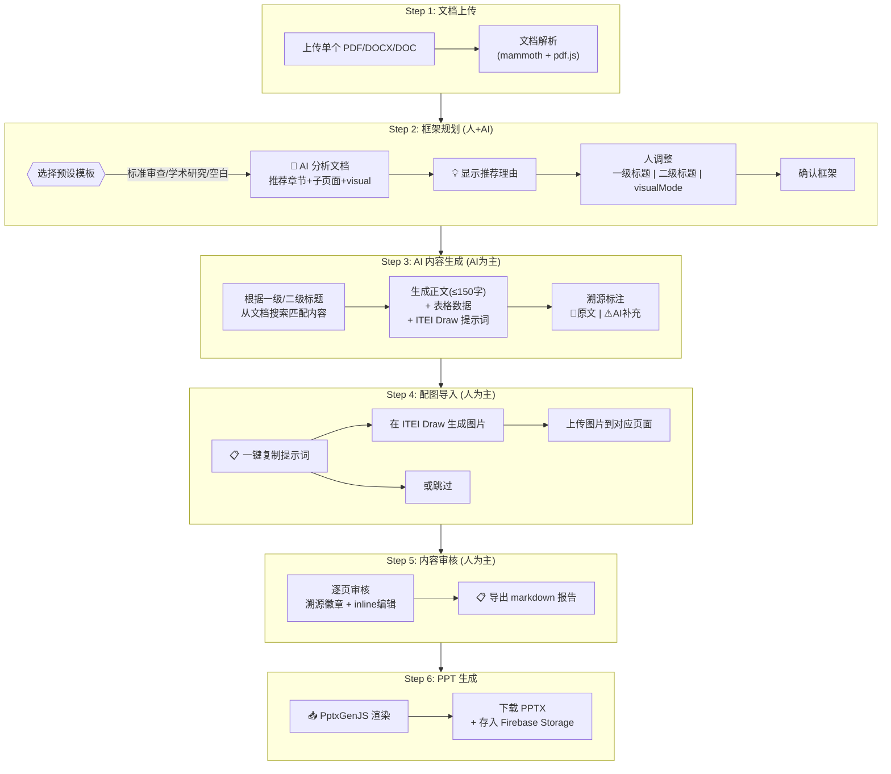

# ITEIPPT v2.0 实现方案（Implementation Plan）

## 目标描述

将当前 v1.0 的单文件原型（`src/index.html`，447KB / 1710行）重构为模块化、可维护、可扩展的 **Vite + React + TypeScript** Web 应用。

v2.0 的全新工作流（6 步）：

```mermaid
flowchart LR
    S1["📄 Step 1\n文档上传"]
    S2["📋 Step 2\n框架规划"]
    S3["🤖 Step 3\nAI内容生成"]
    S4["🖼️ Step 4\n配图导入"]
    S5["✏️ Step 5\n内容审核"]
    S6["📥 Step 6\nPPT生成"]

    S1 -->|"单个 PDF/DOCX/DOC"| S2
    S2 -->|"确认章节+子页"| S3
    S3 -->|"文字+表格+提示词"| S4
    S4 -->|"导入配图"| S5
    S5 -->|"审核通过"| S6
    S6 -->|"PPTX + 存档"| DB[("🗄️ Firebase\nStorage")]

    style S1 fill:#E3F2FD,stroke:#1565C0
    style S2 fill:#FFF3E0,stroke:#E65100
    style S3 fill:#E8F5E9,stroke:#2E7D32
    style S4 fill:#FCE4EC,stroke:#C62828
    style S5 fill:#FFF3E0,stroke:#E65100
    style S6 fill:#E8EAF6,stroke:#283593
    style DB fill:#F3E5F5,stroke:#6A1B9A
```



**交互流程详细图**：



v2.0 的核心改进：
- **模块化架构**：从单 HTML 拆分为组件化前端
- **`template_structure.json` 驱动的模板系统**：以 JSON 模板为权威定义，严格控制 PptxGenJS 渲染
- **预设模板 + 两级标题框架**：内置「标准审查汇报」「学术研究汇报」等预设模板，以一级标题（章节）+ 二级标题（子页面）为编辑单位
- **标题驱动的 AI 内容生成**：AI 根据用户确认的一级/二级标题从文档中搜索匹配内容
- **ITEI Draw 配图流程**：AI 生成图片提示词，用户在外部 ITEI Draw 生成后导入
- **溯源审计系统**：每段内容标注来源（📗原文 / ⚠️AI补充），可视化徽章系统
- **Firebase Storage 版本历史**：每次生成的 PPTX 自动存档

---

## User Review Required

> [!IMPORTANT]
> **AI Studio 全栈部署 + Firebase**
> 方案采用 **AI Studio 全栈部署**，使用 **Firebase Functions** 作为 Gemini API 代理层（隐藏 API Key），前端通过 Firebase Hosting 部署。使用 **Firebase Storage** 保存历史 PPTX 版本。**不上 OAuth**，无用户认证。

> [!IMPORTANT]
> **文档解析范围**
> v2.0 支持导入**单个文件**，格式为 PDF / DOCX / DOC。使用 pdf.js（PDF）和 mammoth.js（DOCX/DOC）解析。文件上传必须在 Step 1 完成，后续步骤不允许追加。

> [!WARNING]
> **图片生成策略 — ITEI Draw 外部工具**
> v2.0 采用 **ITEI Draw 外部生图** 方案：
> 1. Step 3 AI 生成图片提示词（ITEI Draw 可用格式）
> 2. Step 4 用户一键复制提示词 → 在 ITEI Draw 生成图片 → 上传回本系统
> 3. 未导入图片的页面，PPTX 中显示"复制以下内容并在 ITEI Draw 生成PPT配图：[提示词]"
> 4. Future: 系统内直接集成 ITEI Draw API

> [!IMPORTANT]
> **PptxGenJS 模板兼容性**
> v2.0 以 `template_structure.json` 为**权威模板定义**。该 JSON 使用 EMU 精确定位所有元素。PptxGenJS 使用英寸作为坐标单位，需 EMU→inches 转换（`1 inch = 914400 EMU`）。Phase 1 需**优先验证** 4 种页面类型的渲染结果与 `docs/1-*.pptx` 成品一致。

---

## 现状分析

v1.0 的核心问题：
1. **单文件巨石**：所有 UI、CSS、JS、Base64 背景图、模板配置都在一个 HTML 文件中（447KB, 1710行）
2. **模板硬编码**：`TEMPLATE` 对象使用简化的英寸坐标，与 `template_structure.json` 的精确 EMU 定义不一致
3. **无 Analyzer 实现**：AI 内容映射逻辑未编码，全靠手工 prompt
4. **无审核界面**：缺少可视化的逐页审核/编辑流程
5. **PPT 生成不完整**：渲染逻辑骨架存在但未与 Analyzer 输出对接

---

## Proposed Changes

### Phase 1: 项目脚手架与模板系统重构

#### 1.2 模板系统：以 `template_structure.json` 为权威定义

> [!IMPORTANT]
> **设计决策**：v2.0 **废弃** v1.0 的简化 `TEMPLATE` 对象（英寸坐标、手工近似值），改为直接加载 `template_structure.json` 作为运行时模板定义。该 JSON 包含从实际模板 PPT 精确解析的 EMU 坐标，是 PptxGenJS 渲染的唯一权威来源。

`template_structure.json` 的结构分为两层：

**第一层：`slide_types`** — 定义 4 种页面类型的布局规则（通用，不含具体内容）

```json
{
  "slide_types": {
    "cover": {
      "elements": [
        { "role": "standard_name", "position": { "left_emu": 395536, ... }, "font": "微软雅黑", "size_pt": 36 },
        { "role": "main_title",    "position": { ... } },
        { "role": "date",          "position": { ... } },
        { "role": "reporter",      "position": { ... } }
      ]
    },
    "toc_section": { "elements": [ { "role": "page_title" }, { "role": "section_items", "items": [...] } ] },
    "content": {
      "layout_zones": { "top_bar": {...}, "sub_title_area": {...}, "text_content_area": {...}, "visual_area": {...} },
      "elements": [ { "role": "section_title" }, { "role": "sub_title" }, { "role": "body_text" }, { "role": "visual_area" } ],
      "visual_area_modes": { "none": {...}, "table": {...}, "images": {...} }
    },
    "ending": { "elements": [ { "role": "thanks" }, { "role": "organization" }, { "role": "contact_info" } ] }
  }
}
```

**第二层：`slides`** — 默认 21 页的具体排列（可调整页数和每页类型）

```json
{
  "slides": [
    { "slide_number": 1, "slide_type": "cover" },
    { "slide_number": 2, "slide_type": "toc_section" },
    { "slide_number": 3, "slide_type": "content", "visual_mode": "table" },
    ...
  ]
}
```

##### [NEW] [types/template.ts](file:///c:/Users/61973/Documents/cc-projects/ITEIPPT/src/types/template.ts)

为 `template_structure.json` 定义完整的 TypeScript 类型：

```typescript
export interface Position {
  left_emu: number; top_emu: number;
  width_emu: number; height_emu: number;
  left_cm?: number; top_cm?: number;   // 便于调试
  width_cm?: number; height_cm?: number;
}

export interface TemplateElement {
  role: string;                         // 'standard_name' | 'section_title' | 'body_text' | ...
  position?: Position;
  font?: string;
  size_pt?: number;
  bold?: boolean;
  color?: string;
  fill_color?: string;
  alignment?: string;
  // ... 其他属性
}

export interface SlideTypeDefinition {
  description: string;
  layout: string;                       // '空白' | '两栏内容' | '内容'
  elements: TemplateElement[];
  layout_zones?: Record<string, { description: string; position: Position }>;
  visual_area_modes?: Record<string, any>;
}

export interface SlideInstance {
  slide_number: number;
  slide_type: 'cover' | 'toc_section' | 'content' | 'ending';
  visual_mode?: 'none' | 'table' | 'images';
  layout_name: string;
}

export interface TemplateStructure {
  presentation: {
    slide_width_emu: number; slide_height_emu: number;
    total_slides: number;
    layouts: Record<string, { index: number; description: string }>;
    theme_colors: Record<string, string>;
    fonts: Record<string, string>;
  };
  slide_types: Record<string, SlideTypeDefinition>;
  slides: SlideInstance[];
}
```

##### [NEW] [config/templateLoader.ts](file:///c:/Users/61973/Documents/cc-projects/ITEIPPT/src/config/templateLoader.ts)

在运行时加载 `template_structure.json`，提供类型安全的访问接口和 EMU→inches 转换工具：

```typescript
import templateJson from '../../docs/template_structure.json';
import type { TemplateStructure, Position } from '../types/template';

// EMU → PptxGenJS inches 转换
export const emuToInches = (emu: number): number => emu / 914400;

// 将 Position 转为 PptxGenJS 坐标 { x, y, w, h }
export function positionToInches(pos: Position): { x: number; y: number; w: number; h: number } {
  return {
    x: emuToInches(pos.left_emu),
    y: emuToInches(pos.top_emu),
    w: emuToInches(pos.width_emu),
    h: emuToInches(pos.height_emu),
  };
}

// 获取已验证类型的模板
export function getTemplate(): TemplateStructure { return templateJson as TemplateStructure; }

// 获取特定页面类型的布局定义
export function getSlideType(type: string): SlideTypeDefinition { ... }
```

##### [NEW] [config/slidePlan.ts](file:///c:/Users/61973/Documents/cc-projects/ITEIPPT/src/config/slidePlan.ts)

管理「幻灯片计划」— 默认从 `template_structure.json` 的 `slides` 数组加载 21 页计划，但支持动态调整：

```typescript
export interface SlidePlanItem {
  slideNumber: number;
  slideType: 'cover' | 'toc_section' | 'content' | 'ending';
  visualMode?: 'none' | 'table' | 'images';
  // AI Analyzer 或用户自定义的元数据
  chapterTitle?: string;
  subtitle?: string;
  highlightChapter?: number;  // toc_section 高亮第几章
}

// 从 template_structure.json 加载默认 21 页计划
export function loadDefaultSlidePlan(): SlidePlanItem[];

// 动态调整：增/删/移动/修改页面类型
export function addSlide(plan: SlidePlanItem[], afterIndex: number, type: string): SlidePlanItem[];
export function removeSlide(plan: SlidePlanItem[], index: number): SlidePlanItem[];
export function changeSlideType(plan: SlidePlanItem[], index: number, newType: string): SlidePlanItem[];
```

> [!NOTE]
> **灵活性设计**：`template_structure.json` 中的 `slides` 数组提供的是**默认方案**（21页），但实际生成的 PPT 页数和每一页选择哪种类型（cover/toc_section/content/ending）由 AI Analyzer 输出或用户在审核阶段手动调整决定。渲染引擎只关心「每一页是什么类型」，然后去 `slide_types` 查找对应的布局规则。

##### [NEW] [config/assets.ts](file:///c:/Users/61973/Documents/cc-projects/ITEIPPT/src/config/assets.ts)

将 Base64 编码的背景图从 `index.html` 中提取为独立文件（`bg-cover.jpg`、`bg-content.jpg`），转换为 PptxGenJS 兼容的 Base64 data URL：

```typescript
export async function loadBackgroundAssets(): Promise<{
  coverBg: string;    // Base64 data URL (PptxGenJS background.data)
  contentBg: string;
}>;
```

---

### Phase 2: 文档解析服务

##### [NEW] [documentParser.ts](file:///c:/Users/61973/Documents/cc-projects/ITEIPPT/src/services/documentParser.ts)

封装现有的 pdf.js 和 mammoth.js 文档解析逻辑：

```typescript
export interface ParsedDocument {
  filename: string;
  fileType: 'pdf' | 'docx' | 'doc';
  textContent: string;           // 全文纯文本
  sections?: DocumentSection[];  // 提取的章节结构（如果有）
}

export async function parseDocument(file: File): Promise<ParsedDocument>;
```

关键实现：
- PDF → 使用 pdf.js 逐页提取文本
- DOCX/DOC → 使用 mammoth.js 提取 HTML 后转为纯文本
- 仅支持单文件上传（一次处理一份文档）

---

### Phase 3 & 4: 文档→PPT 映射交互设计（核心创新）

> [!IMPORTANT]
> **设计原则**：`notes.md` 中的映射逻辑（章节对应关系、150字浓缩规则、图/表选择）是专家级操作。普通用户不具备这种能力。v2.0 将这个过程拆分为 **4 个渐进式交互步骤**，让 AI 承担专业判断，用户只需在关键节点做「选择题」而非「填空题」。

```
┌─────────────┐    ┌─────────────┐    ┌─────────────┐    ┌─────────────┐
│  Step 2     │───▶│  Step 3     │───▶│  Step 4     │───▶│  Step 5     │
│  框架规划    │    │  AI内容生成  │    │  配图导入    │    │  内容审核    │
│  (人+AI)    │    │  (AI为主)   │    │  (人为主)   │    │  (人为主)   │
└─────────────┘    └─────────────┘    └─────────────┘    └─────────────┘
 选模板→AI推荐    AI填文字+表格     用ITEI Draw生图    人逐页审核
 人调章节/子页     + 图片提示词      导入到对应页面     人改内容
```

---

#### Step 2: 框架规划（FrameworkPlanner）

**目的**：用户先选择预设模板，再上传文档，AI 根据模板结构和文档内容推荐具体的章节/子页面/visual布局。用户以**两级标题**（章节+子页面）为单位操作，不需要理解底层映射规则。

**交互流程**：

```
1. 用户选择预设模板（或空白自定义）
2. 用户上传单个文档（Step 1 完成，支持 PDF/DOCX/DOC）
3. AI 根据模板 + 文档内容，输出「框架建议」：
   - 为每个一级标题建议 1-3 个二级标题（子页面）
   - 为每个子页面建议 visualMode（none/table/images）
   - 每条建议附带推荐理由（如"建议2页，因为编制说明§一有800字内容"）
   - 标注哪些章节内容充足、哪些需要 AI 补充
4. 用户在可视化界面上调整框架（改标题、增删章节/子页面）
```

##### 预设模板（写死在代码中）

每个模板需附带**场景说明**，让用户知道选哪个：

| 模板名称 | 适用场景说明 | 一级标题 | 默认页数 |
|---------|-------------|---------|--------|
| 标准审查汇报 | **团体标准/国家标准的送审稿审查会议汇报**。适用于向标准化委员会汇报标准制定过程和技术内容。 | 项目背景及必要性 / 适用范围及主要内容 / 制定过程 / 先进性创新性 / 经济社会效益 / 其他问题 | ~21 |
| 学术研究汇报 | **学术论文、课题研究的答辩或汇报**。适用于实验研究、临床研究等学术成果展示。 | 研究背景与意义 / 研究目的与假设 / 研究方法 / 主要结果 / 讨论与解读 / 结论与局限性 / 未来展望 | ~20 |
| 空白自定义 | **任意主题**。从零开始手动定义章节和子页面结构。 | 用户手动输入 | 自定义 |

##### UI 设计 — 两级标题框架规划器

```
┌────────────────────────────────────────────────────────────────────────┐
│  📋 PPT 框架规划                                                       │
├────────────────────────────────────────────────────────────────────────┤
│  选择模板:                                                              │
│  [● 标准审查汇报]  [○ 学术研究汇报]  [○ 空白自定义]                      │
│      团体标准/国家标准送审稿审查会议汇报                                  │
├────────────────────────────────────────────────────────────────────────┤
│                                                                        │
│  ┌─ 封面 ──────────────────────────────────────── 1张 ──────────┐     │
│  │  标题、汇报人、日期、所属机构                                 │     │
│  └──────────────────────────────────────────────────────────────┘     │
│                                                                        │
│  ┌─ 一、项目背景及必要性 ──────────────────── 2张  [+子页] [×] ─┐     │
│  │  💡 建议2页：项目建议书§目的意义 有~800字内容可支撑            │     │
│  │                                                              │     │
│  │  ┌──────────────────┐  ┌──────────────────┐                  │     │
│  │  │ 项目背景及意义   │  │ 必要性分析       │  [+ 添加子页]    │     │
│  │  │ 📊 表格          │  │ 🖼️ 双图          │                  │     │
│  │  │ [✏️改名] [改visual]│ │ [✏️改名] [改visual]│                  │     │
│  │  └──────────────────┘  └──────────────────┘                  │     │
│  └──────────────────────────────────────────────────────────────┘     │
│                                                                        │
│  ┌─ 二、项目适用范围及主要内容 ──────────────── 2张  [+子页] [×] ─┐   │
│  │  💡 建议2页：送审稿§1 + 项目建议书§范围 有~500字               │     │
│  │  ┌──────────────────┐  ┌──────────────────┐                  │     │
│  │  │ 适用范围         │  │ 主要内容         │  [+ 添加子页]    │     │
│  │  │ 🖼️ 单图          │  │ 📊 表格          │                  │     │
│  │  └──────────────────┘  └──────────────────┘                  │     │
│  └──────────────────────────────────────────────────────────────┘     │
│                                                                        │
│  ...更多章节...                                                        │
│                                                                        │
│  ┌─ 结束页 ──────────────────────────────── 1张 ────────────────┐     │
│  │  敬请指正！ + 单位信息                                        │     │
│  └──────────────────────────────────────────────────────────────┘     │
│                                                                        │
│  [+ 添加章节]                                                          │
│                                                                        │
├────────────────────────────────────────────────────────────────────────┤
│  📊 共 6 章 | 14 页内容 + 封面 + 6 目录 + 结束 = 22 页总计              │
│  ⚠️ 第五章「预期经济社会效益」素材较少，AI 将补充约 40% 内容             │
│                          [确认框架，开始生成内容 →]                     │
└────────────────────────────────────────────────────────────────────────┘
```

**关键交互**：
- **模板选择含场景说明**：每个模板名下面有一行灰色说明文字
- **两级编辑**：一级标题（章节名，可编辑/增删/拖拽排序）、二级标题（子页面名+visualMode，可编辑/增删）
- **AI 推荐理由**：每个章节下方显示💡建议文字，说明为什么推荐该页数和布局
- **目录页自动生成**：用户不管目录页，每增加一个章节自动在前面插入 `toc_section`
- **一级/二级标题可改名**：改名后 AI 在 Step 3 会根据新标题从文档中搜索匹配内容
- **总计统计栏**：底部显示总页数、AI补充预警

##### 数据结构

```typescript
// 预设模板定义
export interface TemplatePreset {
  id: string;                           // 'standard_review' | 'academic_research' | 'blank'
  name: string;                         // 显示名
  description: string;                   // 场景说明
  chapters: {
    title: string;                       // 一级标题
    defaultSubtitles: {
      subtitle: string;                  // 二级标题
      visualMode: 'none' | 'table' | 'images';
      contentHint: string;               // 内容要点提示
    }[];
  }[];
}

// Step 2 的输出：两级框架
export interface FrameworkPlan {
  presetId: string;
  coverInfo: { standardName?: string; planNumber?: string; presenter?: string; date?: string };
  chapters: ChapterPlan[];
  endingInfo: { organization?: string; contactInfo?: string[] };
}

export interface ChapterPlan {
  chapterIndex: number;                 // 1-based
  chapterTitle: string;                  // 一级标题（如"一、项目背景及必要性"）
  slides: SubSlidePlan[];               // 该章节下的子页面
  aiReason?: string;                    // AI 推荐理由
  coverageLevel?: 'sufficient' | 'moderate' | 'sparse';
  sourceHint?: string;                  // 内容来源提示（如"项目建议书§目的意义"）
}

export interface SubSlidePlan {
  subtitle: string;                      // 二级标题（如"项目背景及意义"）
  visualMode: 'none' | 'table' | 'images';
  contentHint?: string;                  // 内容要点提示
}

// 系统自动从 chapters 派生完整页面序列：
// cover + (toc_section + content×N) × chapters + ending
```

##### Firebase Function: `POST /api/plan`

```typescript
// 输入：presetId + 单份文档的解析文本
// 输出：FrameworkPlan（含 AI 推荐理由 + 章节充足度分析）
// AI 根据预设模板的一级/二级标题，在文档中搜索匹配内容，评估充足度
```

---

#### Step 3: AI 内容生成（ContentGenerator）

**目的**：用户确认框架后，AI **根据一级标题和二级标题从上传文档中搜索匹配内容**，逐页填充正文、表格和图片提示词。

> [!IMPORTANT]
> **标题驱动内容搜索**：如果用户在 Step 2 修改了一级/二级标题（如将"项目背景及意义"改为"立项依据"），AI 必须根据**新标题**去文档中重新搜索匹配内容，而非按默认映射规则查找。

**交互流程**：

```
1. 用户在 Step 2 确认框架（如 6 章 22 页）
2. AI 根据每页的一级+二级标题，在文档中搜索相关内容：
   - 封面页：提取标准名称、计划号、汇报人
   - 内容页：浓缩正文（≤150字）、生成表格数据
   - 图片页：生成 ITEI Draw 可用的图片提示词
   - 溯源标注：标记每段内容来自哪份文件的哪个章节
   - AI补充标注：标记哪些内容是 AI 推理/补充的
3. 显示进度条动画（带逐页完成状态）
```

**UI 设计 — 带动画的进度看板**：

```
┌────────────────────────────────────────────────────────────────────┐
│  🤖 AI 正在生成内容... (12/22)                                    │
├────────────────────────────────────────────────────────────────────┤
│                                                                    │
│  ✅ #1  封面页              已完成                                 │
│  ✅ #2  目录页 → Ch1        已完成                                 │
│  ✅ #3  项目背景及意义       已完成 — 📊表格 + 📄项目建议书§目的意义 │
│  ✅ #4  必要性分析           已完成 — 🖼️提示词×2 + ⚠️含2处AI补充    │
│  ...                                                               │
│  🔄 #12 目录页 → Ch4        生成中...  ⟳                          │
│  ⏳ #13 国内外先进性         等待中                                 │
│  ...                                                               │
│                                                                    │
│  ▓▓▓▓▓▓▓▓▓▓▓▓▓▓▓▓▓▓▓░░░░░░░░░ 55%  ← 动画进度条                  │
├────────────────────────────────────────────────────────────────────┤
│  📊 来源素材: 85%  |  AI补充: 15%  |  图片提示词: 7 张待生成       │
└────────────────────────────────────────────────────────────────────┘
```

##### 数据结构

```typescript
export interface SlideContent {
  page: number;
  type: 'cover' | 'toc_section' | 'content' | 'ending';
  
  // 封面页 (cover)
  standardName?: string;
  planNumber?: string;
  reportTitle?: string;
  presenter?: string;
  date?: string;
  
  // 目录页 (toc_section)
  highlightChapter?: number;
  
  // 内容页 (content)
  chapterTitle?: string;          // 一级标题（蓝色横条）
  subtitle?: string;              // 二级标题（蓝色矩形）
  bodyText?: string;              // 正文（≤150字）
  highlightRanges?: [number, number][];  // 红色高亮区间
  
  // 下方区域 (content 页)
  visualMode?: 'none' | 'table' | 'images';
  tableData?: {
    headers: string[];
    rows: string[][];
    headerFillColor?: string;
  };
  // 图片提示词 — 用于 ITEI Draw 生成配图
  imagePrompts?: {
    description: string;           // 图片描述（如"绘制医用呼吸机压力传感器市场格局饼图"）
    iteiDrawPrompt: string;        // ITEI Draw 可直接使用的提示词
  }[];
  imageFiles?: string[];           // 实际导入的图片文件名（Step 4 填入）
  
  // 结束页 (ending)
  organization?: string;
  contactInfo?: string[];
  
  // ✨ 溯源与审计
  sourceRef?: string;
  sourceConfidence: 'exact' | 'paraphrased' | 'ai_inferred' | 'ai_constructed';
  aiSupplements?: {
    description: string;
    type: 'common_knowledge' | 'ai_summary' | 'ai_inference' | 'ai_construction' | 'chart_design';
  }[];
}

export interface AnalyzerResult {
  slidePlan: SlideContent[];
  sourceFiles: { id: number; filename: string; shortName: string }[];
  missingInfo: { page: number; description: string; solution: string }[];
  imagePromptsTotal: number;       // 需要生成的图片总数
  auditSummary: {
    totalSlides: number;
    exactSourcePercent: number;
    aiSupplementCount: number;
    missingCount: number;
  };
}
```

##### Firebase Function: `POST /api/generate-content`

```typescript
// 输入：FrameworkPlan（含一级/二级标题）+ 单份文档文本
// 输出：AnalyzerResult（含溯源标注 + AI补充清单 + 图片提示词）
// 使用 SSE 流式返回进度
// 关键：AI 根据用户确认的一级/二级标题去文档中搜索内容
```

**System Prompt 设计要点**：
1. 注入用户确认的 FrameworkPlan（一级/二级标题作为搜索关键词）
2. 注入 `notes_utf8.md` 第 5.1 节的映射规则作为参考
3. 以 `Standard-Analyzer-1.md` 作为 few-shot 示例
4. **标题驱动**：根据每页的一级+二级标题在文档中定位匹配段落
5. **强制溯源输出**：每段内容必须标注 `sourceRef` 和 `sourceConfidence`
6. **图片提示词格式**：为 visualMode='images' 的页面生成 ITEI Draw 可用的提示词

---

#### Step 4: 配图导入（ImageImporter）

**目的**：Step 3 生成的图片提示词需要用户在 **ITEI Draw**（外部工具，调用 Google 生图 API）中生成实际图片，然后导回本系统。

**UI 设计**：

```
┌────────────────────────────────────────────────────────────────────┐
│  🖼️ 配图导入 — 共 7 张图片待生成                                   │
├────────────────────────────────────────────────────────────────────┤
│                                                                    │
│  #4  必要性分析 — 图片1                                            │
│  ┌────────────────────────────────────────────────────────────┐    │
│  │ 📋 ITEI Draw 提示词（点击一键复制）：                       │    │
│  │ "绘制一张医用呼吸机压力传感器市场格局饼图，展示国外品牌     │    │
│  │  （霍尼韦尔、First Sensor、TE等）占80%市场份额..."          │    │
│  │                                          [📋 复制提示词]   │    │
│  └────────────────────────────────────────────────────────────┘    │
│  图片状态: ○ 未导入                                                │
│  [📤 上传图片]  [⏭️ 跳过此图]                                      │
│                                                                    │
│  ─ ─ ─ ─ ─ ─ ─ ─ ─ ─ ─ ─ ─ ─ ─ ─ ─ ─ ─ ─ ─ ─ ─ ─ ─ ─ ─ ─    │
│                                                                    │
│  #4  必要性分析 — 图片2                                            │
│  ┌────────────────────────────────────────────────────────────┐    │
│  │ 📋 "绘制呼吸机核心部件国产化瓶颈示意图，以呼吸机为中心..." │    │
│  │                                          [📋 复制提示词]   │    │
│  └────────────────────────────────────────────────────────────┘    │
│  图片状态: ✅ 已导入  [预览] [替换]                                  │
│                                                                    │
│  ...更多图片...                                                    │
│                                                                    │
├────────────────────────────────────────────────────────────────────┤
│  📊 已导入: 3/7  |  跳过: 1  |  未处理: 3                          │
│                     [全部跳过，进入审核 →]  [继续审核 →]            │
└────────────────────────────────────────────────────────────────────┘
```

**关键交互**：
- **一键复制提示词**：点击按钮直接复制到剪贴板，用户去 ITEI Draw 粘贴生成图片
- **上传图片**：用户从 ITEI Draw 下载图片后上传到对应位置
- **跳过**：如果某张图暂时不需要，可以跳过（PPT 中不放图，保留文字描述）
- **全部跳过**：不生成任何配图，直接进入审核（图片位置留空或填充描述文字）
- **生成PPT中的提示**：最终生成的 PPTX 中，未导入图片的页面会在图片区域显示提示文字："复制以下内容并在 ITEI Draw 生成PPT配图：[提示词内容]"

> [!NOTE]
> ITEI Draw 是一个独立的外部工具（调用 Google 生图 API），与本项目无关。本系统仅负责：(1) 生成优质提示词，(2) 提供复制按钮，(3) 接收用户上传的成品图片。

---

#### Step 5: 内容审核（ContentAuditor）

**目的**：用户逐页审核 AI 生成的内容 + 导入的配图。溯源徽章帮助用户识别哪些内容来自原文、哪些是 AI 补充。

**UI 设计 — 双栏审核面板**（保持原有设计，图片区域改为显示已导入的图片或提示词）：

- 左侧：PPT 页面预览（包含已导入的图片）
- 右侧：可编辑表单 + 溯源信息
- 📗 绿色溯源徽章 = 来自原文
- ⚠️ 黄色溯源徽章 = AI 补充，需人工确认
- 正文编辑：带字数统计的文本框（150字限制）
- 表格 inline 编辑：直接在单元格中编辑，支持增删行列
- 图片区域：显示已导入的配图或"未导入"状态（可重新上传替换）
- 页面级操作：删除页面、修改 visualMode
- 📋 导出报告：导出为 markdown（等价于 `Standard-Analyzer-*.md`）

##### 审核状态数据

```typescript
export interface AuditState {
  slides: (SlideContent & {
    auditStatus: 'pending' | 'reviewed' | 'modified';
    userNotes?: string;
  })[];
  overallProgress: number;
  warningCount: number;
}

---

### Phase 5: PPT 渲染引擎（严格遵循 `template_structure.json`）

##### [NEW] [pptRenderer.ts](file:///c:/Users/61973/Documents/cc-projects/ITEIPPT/src/services/pptRenderer.ts)

基于 PptxGenJS，将审核后的 `SlideContent[]` 渲染为 PPTX 文件。**所有坐标、字体、颜色均从 `template_structure.json` 的 `slide_types` 读取**，不硬编码任何布局参数：

```typescript
import { getTemplate, positionToInches, getSlideType } from '../config/templateLoader';

export async function renderPPTX(
  slides: SlideContent[],
  backgrounds: { coverBg: string; contentBg: string },
  imageFiles: Map<string, ArrayBuffer>
): Promise<Blob> {
  const template = getTemplate();
  const pptx = new PptxGenJS();
  
  // 使用 template_structure.json 的精确尺寸
  pptx.defineLayout({
    name: 'ITEI',
    width: template.presentation.slide_width_emu / 914400,
    height: template.presentation.slide_height_emu / 914400,
  });
  pptx.layout = 'ITEI';
  
  for (const slideContent of slides) {
    const typeDef = getSlideType(slideContent.type);  // 查找布局规则
    const slide = pptx.addSlide();
    renderSlideByType(slide, slideContent, typeDef, backgrounds, imageFiles);
  }
  return pptx.write({ outputType: 'blob' });
}
```

**渲染逻辑** — 每种类型从 `slide_types` 读取 `elements[]` 的 `role` + `position`：

1. **封面页 (cover)**：
   - 背景图 → `coverBg`
   - 遍历 `slide_types.cover.elements`，按 `role` 匹配内容：
     - `standard_name` → `slideContent.standardName`
     - `main_title` → `slideContent.reportTitle`
     - `date` → `slideContent.date`
     - `reporter` → `slideContent.presenter`
   - 每个元素的 `position` 通过 `positionToInches()` 转为 PptxGenJS 坐标

2. **目录页 (toc_section)**：
   - 背景图 → `contentBg`
   - `slide_types.toc_section.elements` 中 `section_items.items` 定义 6 个章节条
   - `slideContent.highlightChapter` 决定哪个条目高亮
   - 位置坐标从 `template_structure.json` 的 `slides[n].shapes` Group 结构读取

3. **内容页 (content)**：
   - 背景图 → `contentBg`
   - `layout_zones` 定义 4 个区域：`top_bar` / `sub_title_area` / `text_content_area` / `visual_area`
   - 按 `visual_area_modes[slideContent.visualMode]` 选择下方区域渲染方式
   - 表格使用 `visual_area_modes.table.default_position`
   - 图片使用 `visual_area_modes.images.single_image_centered` 或 `two_images_side_by_side`

4. **结束页 (ending)**：
   - 背景图 → `coverBg`
   - 遍历 `slide_types.ending.elements`，按 `role` 匹配：`thanks` / `organization` / `contact_info`

---

### Phase 6: 主工作流与状态管理

##### [NEW] [useWorkflow.ts](file:///c:/Users/61973/Documents/cc-projects/ITEIPPT/src/hooks/useWorkflow.ts)

管理 6 个步骤的工作流状态：

```typescript
type WorkflowStep = 
  | 'upload'           // Step 1: 文档上传（必须在此步完成所有文件上传）
  | 'framework'        // Step 2: 框架规划 (选模板 + AI推荐 + 人调整)
  | 'content'          // Step 3: AI 内容生成 (AI为主，带动画进度条)
  | 'images'           // Step 4: 配图导入 (用ITEI Draw生图后上传)
  | 'audit'            // Step 5: 内容审核 (人为主)
  | 'generate';        // Step 6: PPT 生成

interface WorkflowState {
  currentStep: WorkflowStep;
  documents: ParsedDocument[];       // Step 1 输出
  frameworkPlan: FrameworkPlan;       // Step 2 输出
  analyzerResult: AnalyzerResult;     // Step 3 输出
  importedImages: Map<string, File>;  // Step 4 输出
  auditState: AuditState;             // Step 5 输出
  generatedBlob: Blob | null;         // Step 6 输出
}
```

##### [NEW] [App.tsx](file:///c:/Users/61973/Documents/cc-projects/ITEIPPT/src/App.tsx)

主应用组件，步骤路由：

```tsx
function App() {
  const workflow = useWorkflow();
  return (
    <>
      <Header />
      <Stepper steps={[
        { key: 'upload', label: '文档上传' },
        { key: 'framework', label: '框架规划' },
        { key: 'content', label: '内容生成' },
        { key: 'images', label: '配图导入' },
        { key: 'audit', label: '内容审核' },
        { key: 'generate', label: 'PPT生成' },
      ]} currentStep={workflow.currentStep} />
      <div className="container">
        {workflow.currentStep === 'upload' && <UploadPanel />}
        {workflow.currentStep === 'framework' && <FrameworkPlanner />}
        {workflow.currentStep === 'content' && <ContentGenerator />}
        {workflow.currentStep === 'images' && <ImageImporter />}
        {workflow.currentStep === 'audit' && <ContentAuditor />}
        {workflow.currentStep === 'generate' && <GeneratePanel />}
      </div>
    </>
  );
}
```

---

### Phase 7: UI 组件与样式

##### [NEW] [App.css](file:///c:/Users/61973/Documents/cc-projects/ITEIPPT/src/App.css)

从 `index.html` 的 `<style>` 块提取 CSS，重构为模块化：

- 保持现有设计系统（CSS 变量、配色方案）
- ITEI 品牌色：深蓝 `#0A406C`、亮蓝 `#0088D0`、品牌红 `#BA1F25`
- 字体：Noto Sans SC + JetBrains Mono
- 组件化样式：卡片、按钮、模态框、表格、上传区等

---

### Phase 8: Firebase Storage — PPTX 版本历史

每次生成 PPTX 时，自动上传到 Firebase Storage 保留历史版本：

```typescript
// 存储路径: pptx-versions/{timestamp}_{standardName}.pptx
// 前端可查看历史版本列表，下载过去的 PPTX
export async function savePptxVersion(blob: Blob, metadata: {
  standardName: string;
  generatedAt: string;
  totalSlides: number;
}): Promise<string>;  // 返回下载 URL

export async function listPptxVersions(): Promise<PptxVersion[]>;
```

> [!NOTE]
> 不上 OAuth，Firebase Storage 规则设为公开写入（或使用匿名认证）。后续可加用户认证后限制访问。

---

## Open Questions

> [!NOTE]
> **2. 表格渲染风格**
> 表格的表头颜色（`#044470`）、斑马纹（`#F2F7FB` / `#FFFFFF`）已在 `template_structure.json` 的 slide 3 表格 shapes 中定义。渲染引擎将直接读取这些颜色值。

---

## Verification Plan

### Automated Tests

1. **类型检查**：`npx tsc --noEmit` — 确保所有类型定义正确
2. **构建验证**：`npm run build` — 确保 Vite 打包成功
3. **开发服务器**：`npm run dev` — 验证 HMR 和页面渲染

### Manual Verification

1. **模板验证（Phase 1 门禁）**：
   - 从 `template_structure.json` 生成一个测试 PPTX（含 4 种页面类型）
   - 与 `docs/1-*.pptx` 成品对比布局、颜色、字体、定位
   - **此步必须通过才能继续后续开发**

2. **工作流完整性测试（6 步）**：
   - Step 1: 上传单个测试文档（PDF/DOCX/DOC）
   - Step 2: 选择「标准审查汇报」模板，验证 AI 推荐理由和两级标题编辑
   - Step 3: 验证 AI 内容生成（带进度条动画），对齐 `Standard-Analyzer-1.md`
   - Step 4: 验证配图导入流程（提示词复制 + 图片上传）
   - Step 5: 逐页审核，验证溯源徽章正确显示
   - Step 6: 生成 PPTX，验证 Firebase Storage 版本保存
   
3. **溯源审计验证**：
   - 确认 `sourceConfidence` 徽章正确区分原文引用 vs AI 补充
   - 确认 `aiSupplements` 清单与 `Standard-Analyzer-1.md` 的 14 处补充一致
   - 确认导出的 markdown 报告格式与 `Standard-Analyzer-1.md` 等价

4. **PPTX 图片提示词验证**：
   - 未导入图片的 PPTX 页面，图片区域应显示"复制以下内容并在 ITEI Draw 生成PPT配图：[提示词]"
   - 已导入图片的页面应正确嵌入图片

5. **边界场景测试**：
   - 上传无效文件格式
   - 网络断开时 SSE 流式生成的容错
   - 超长文本内容的截断处理
   - 空文档/缺失文档的容错

---

## 实施优先级 & 里程碑

### MVP (Week 1-2)
- [ ] Phase 1: 项目脚手架 + `template_structure.json` 加载器 + **PptxGenJS 模板验证**
- [ ] Phase 2: 文档解析服务
- [ ] Phase 5: PPT 渲染引擎（严格遵循 `template_structure.json`，含图片提示词占位）
- [ ] Phase 7: 基础 UI 框架（6 步步骤条）
- [ ] Firebase 项目初始化 + Hosting + Storage 配置

### Iteration 1 (Week 3)
- [ ] Step 2: 框架规划器（预设模板 + 两级标题编辑 + AI 推荐理由）
- [ ] Step 3: AI 内容生成 + Firebase Function `POST /api/generate-content` (SSE + 进度动画)
- [ ] Phase 6: 工作流状态管理（6 步）

### Iteration 2 (Week 4)
- [ ] Step 4: 配图导入面板（提示词一键复制 + 图片上传）
- [ ] Step 5: 内容审核面板（溯源徽章 + inline 编辑）
- [ ] Phase 8: Firebase Storage PPTX 版本历史
- [ ] 导出 markdown 报告功能
- [ ] 端到端测试与 AI Studio 部署验证

### Future (Post v2.0)
- [ ] ITEI Draw 集成（在系统内直接调用生图 API）
- [ ] 多模板支持（用户自定义模板）
- [ ] 批量处理模式
- [ ] 用户认证与项目管理

